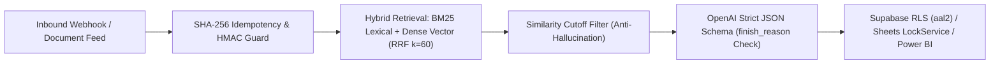
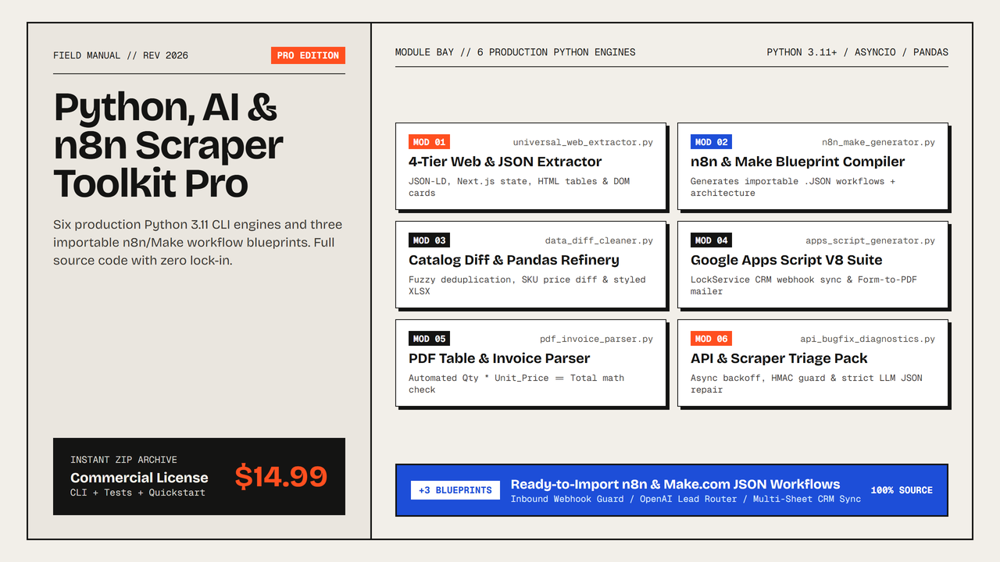

# AI Automation, Hybrid RAG & Workflow Engineering Toolkit

<div align="center">
  <p align="center">
    <a href="https://www.python.org/"></a>
    <a href="https://fastapi.tiangolo.com/"></a>
    
    
    
    <a href="https://trungthanh16.gumroad.com/l/python-ai-automation-n8n-scraper-toolkit-pro"></a>
  </p>
</div>

Deterministic, production-tested Python 3.11+, SQL, and V8 Google Apps Script reference architectures for **Hybrid RAG Diagnostics (`BM25 + Dense Vector RRF`)**, **FastAPI + OpenAI Strict `json_schema` Pipelines**, **Bounded Stream Backpressure**, **Supabase `aal2` MFA Row-Level Security (`pgTAP`)**, and **ERP / Workspace Sync Engines**.

---

## 1. Included Open-Source Engineering Modules

| Module | Source File | Production Problem Solved |
| :--- | :--- | :--- |
| **1. Hybrid RAG Pipeline Auditor (`BM25 + Dense RRF`)** | [`src/rag_hybrid_rerank_auditor.py`](./src/rag_hybrid_rerank_auditor.py) | Diagnoses chunk-boundary fragmentation and benchmarks pure dense cosine search against **Hybrid BM25 + Vector Reciprocal Rank Fusion (`RRF, k=60`)** with similarity cutoff guards to eliminate hallucinations. |
| **2. FastAPI + OpenAI Structured Outputs Service** | [`src/fastapi_openai_structured_rag_service.py`](./src/fastapi_openai_structured_rag_service.py) | Enforces 100% deterministic JSON schema responses (`strict: true`), catches token truncation (`finish_reason == "length"`), and implements `SHA-256` idempotent webhook routing. |
| **3. Live Stream Backpressure & Micro-Batching Engine** | [`src/stream_backpressure_and_microbatch_engine.py`](./src/stream_backpressure_and_microbatch_engine.py) | Prevents queue memory exhaustion on live video/telemetry feeds using bounded ring buffers (`deque(maxlen=2)`), micro-batch inference grouping, and zero-downtime atomic model hot-swapping. |
| **4. Supabase / PostgreSQL RLS & `aal2` MFA `pgTAP` Suite** | [`sql_and_apps_script/supabase_rls_aal2_pgtap_audit_suite.sql`](./sql_and_apps_script/supabase_rls_aal2_pgtap_audit_suite.sql) | Verifies multi-tenant isolation, `SECURITY INVOKER` views, `WITH CHECK` write guards, and `auth.jwt()->>'aal' = 'aal2'` MFA enforcement across `anon` and `authenticated` roles. |
| **5. Google Sheets & Maps Smart Route Planner** | [`sql_and_apps_script/google_sheets_haversine_route_planner.js`](./sql_and_apps_script/google_sheets_haversine_route_planner.js) | Google Apps Script that geocodes property addresses, runs Nearest-Neighbor Haversine TSP route optimization within configurable time windows, and generates 1-click multi-stop Google Maps URLs. |
| **6. Odoo ERP to Power BI Inventory Connector** | [`sql_and_apps_script/odoo_erp_to_powerbi_connector.py`](./sql_and_apps_script/odoo_erp_to_powerbi_connector.py) | Maps Odoo's core inventory models (`stock.quant`, `stock.move`, `product.product`, `stock.location`, `stock.warehouse`) to Power BI via PostgreSQL Views and `Web.Contents` (`RelativePath`) Power Query M scripts for cloud Scheduled Refresh. |

---

## 2. Quickstart & Self-Test Verification (30 Seconds)

Every core Python benchmark in `src/` runs deterministically out of the box so you can verify recall, latency, and backpressure behavior immediately:

```bash
git clone https://github.com/Tthanh2k6/ai-automation-and-rag-toolkit.git
cd ai-automation-and-rag-toolkit

# 1. Run the Hybrid RAG Diagnostic Benchmark (Dense Cosine vs. BM25 + Vector RRF)
python src/rag_hybrid_rerank_auditor.py

# 2. Run the Bounded Stream Backpressure & Atomic Model Hot-Swap Demo
python src/stream_backpressure_and_microbatch_engine.py

# 3. Run the FastAPI + OpenAI Structured RAG Pipeline Self-Test
python src/fastapi_openai_structured_rag_service.py
```

---

## 3. End-to-End Deterministic Architecture



---

## 4. Open-Core Reference Repo vs. Complete Pro Toolkit (`$14.99`)

All 6 RAG, FastAPI, Stream Backpressure, PostgreSQL `pgTAP`, Route TSP, and Odoo BI reference modules in **this GitHub repository remain 100% open and free**.

If you also need **standalone CLI data extraction, supplier catalog price/stock diffing, deterministic PDF commercial invoice math reconciliation, concurrency-safe V8 Google Workspace syncs, and ready-to-import `n8n` & `Make.com` JSON blueprints**, grab the companion **Toolkit Pro** archive:

<p align="center">
  <a href="https://trungthanh16.gumroad.com/l/python-ai-automation-n8n-scraper-toolkit-pro">
    
  </a>
</p>

| Capability / Deliverable | Community GitHub Repo (Here — Free) | Complete Toolkit Pro (`$14.99` Instant `.ZIP`) |
| :--- | :---: | :---: |
| **Hybrid BM25 + Vector RRF Auditor & FastAPI Structured RAG** | ✅ | — *(Complementary Repo)* |
| **Supabase `aal2` RLS `pgTAP` Audit + Odoo Power BI Connector** | ✅ | — *(Complementary Repo)* |
| **4-Tier Structured Web Data CLI (`JSON-LD` -> SSR State -> `<table>` -> DOM)** | ❌ | ✅ (`universal_web_extractor.py`) |
| **Catalog Deduplication & Price/Stock Delta Diff Engine (`.xlsx` + `.csv`)** | ❌ | ✅ (`data_diff_and_cleaner_poc.py`) |
| **Deterministic PDF Invoice Table Parser (`Qty * Unit_Price == Total` Check)** | ❌ | ✅ (`pdf_and_document_parser_poc.py`) |
| **5 Concurrency-Safe V8 Google Apps Scripts (`LockService` + 2D Batch Arrays)** | 1 Route Planner | ✅ Full 5-Template Generator Suite |
| **Production API Resilience Suite (HMAC `timingSafeEqual`, Async 429 Backoff)** | ❌ | ✅ (`api_bugfix_diagnostic_generator.py`) |
| **3 Ready-to-Import `n8n` & `Make.com` JSON Blueprints + Diagram Compiler** | ❌ | ✅ (`workflows/` + `n8n_make_workflow_generator.py`) |

👉 **[Get the Complete 6-Engine Python & n8n Toolkit Pro (`$14.99` Instant Download)](https://trungthanh16.gumroad.com/l/python-ai-automation-n8n-scraper-toolkit-pro)**

---

## 5. Production Failure Modes & Edge Cases Solved (`Production Gotchas`)

1. **Why Pure Dense Vector RAG Fails on Exact SKUs, Part Numbers & Clauses:** Dense embeddings compress alphanumeric codes (`SKU-8841-B`, `ISO-27001 §A.8.2`) into fuzzy semantic neighborhoods. Pairing lexical **BM25** with dense cosine similarity via **Reciprocal Rank Fusion (`score = Σ 1 / (k + rank_i)`, `k=60`)** recovers exact identifier precision without sacrificing semantic recall.
2. **Silent JSON Truncation Under `strict: true`:** Setting `response_format={"type": "json_schema", "strict": True}` guarantees grammar adherence *until* generation hits `max_completion_tokens` (`finish_reason == "length"`), emitting a half-closed JSON string. Always inspect `choice.finish_reason` before `json.loads()` and enforce `"additionalProperties": False` on every nested object.
3. **Supabase PostgreSQL Views Bypassing RLS by Default:** In PostgreSQL, views execute with the privileges of the view owner (`SECURITY DEFINER` behavior) unless explicitly created with `WITH (security_invoker = true)`. Combine `security_invoker = true` with `pgTAP` assertions testing `anon`, `authenticated` (`aal1`), and MFA-verified (`aal2`) JWT claims.
4. **Power BI Cloud Refresh Failing on Dynamic REST Endpoints:** Power BI Service blocks scheduled refresh when URL strings are concatenated dynamically before `Web.Contents()`. Always pass a static base URL as the first argument to `Web.Contents(BaseUrl, [RelativePath = ..., Query = ...])`.

---

## 6. Omnichannel Ecosystem, Cloud Actors & Engineering Articles

- **Gumroad Digital Toolkits (`Python + n8n + Apps Script Pro`):** [trungthanh16.gumroad.com/l/python-ai-automation-n8n-scraper-toolkit-pro](https://trungthanh16.gumroad.com/l/python-ai-automation-n8n-scraper-toolkit-pro)
- **Apify Store (Managed Cloud Data & Enrichment Actors):** [apify.com/thanh81646](https://apify.com/thanh81646)
- **DEV Community (Production Architecture Deep-Dives):** [dev.to/tthanh2k6](https://dev.to/tthanh2k6)
- **Engineering Portfolio & Live Demos:** [portfolio-red-theta-65.vercel.app](https://portfolio-red-theta-65.vercel.app/)
- **GitHub:** [@Tthanh2k6](https://github.com/Tthanh2k6)

---

## 7. Author

**Trung Thanh Tran** — Software, Data Extraction, Hybrid RAG & Workflow Automation Engineer  
*HackerRank Certified in Software Engineering, REST APIs, SQL, Node.js & JavaScript.*
