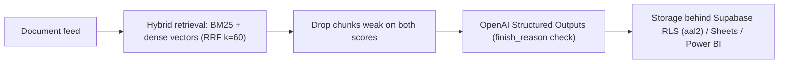
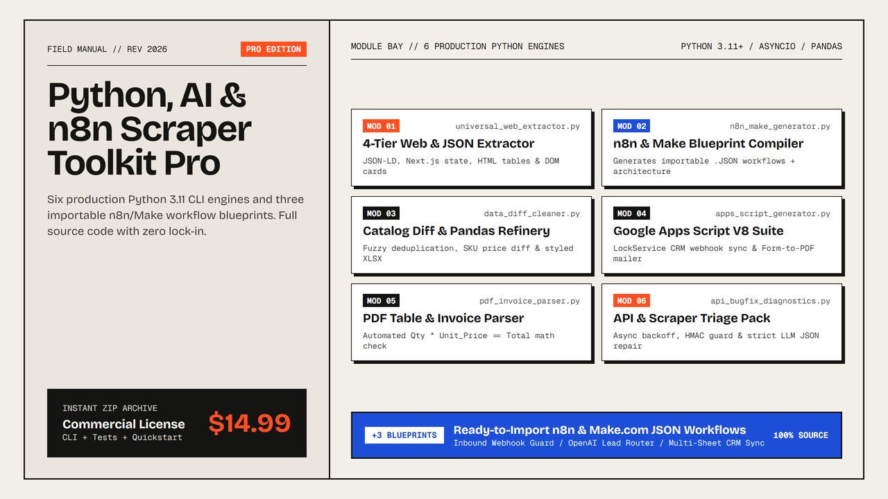

# AI Automation, Hybrid RAG & Workflow Engineering Toolkit

<div align="center">
  <p align="center">
    <a href="https://www.python.org/"></a>
    <a href="https://fastapi.tiangolo.com/"></a>
    
    
    
    <a href="https://trungthanh16.gumroad.com/l/python-ai-automation-n8n-scraper-toolkit-pro"></a>
  </p>
</div>

Small reference implementations in Python 3.11+, SQL and Google Apps Script: **hybrid RAG retrieval (`BM25 + dense vectors, RRF`)**, a **FastAPI + OpenAI Structured Outputs** endpoint, a **bounded stream buffer / micro-batching** sketch, a **Supabase `aal2` row-level security policy with a pgTAP test**, a **Google Sheets route planner** and **Odoo → Power BI** views. They are examples to read and adapt, not a packaged library; the SQL, Apps Script and Odoo files have not been run against a live database or sheet.

---

## 1. Modules

| Module | Source File | Problem it addresses |
| :--- | :--- | :--- |
| **1. Hybrid RAG Pipeline Auditor (`BM25 + Dense RRF`)** | [`src/rag_hybrid_rerank_auditor.py`](./src/rag_hybrid_rerank_auditor.py) | Flags weak chunks (too short/long, cut mid-sentence, no section header) and fuses a dense cosine ranking with an Okapi **BM25** ranking via **Reciprocal Rank Fusion (`k=60`)**, dropping documents weak on both signals. The built-in demo uses hand-made toy vectors; it is not a benchmark. |
| **2. FastAPI + OpenAI Structured Outputs Service** | [`src/fastapi_openai_structured_rag_service.py`](./src/fastapi_openai_structured_rag_service.py) | `POST /api/ai-feature`: small embedding-based retrieval over 3 sample docs, then an OpenAI Structured Outputs call parsed into a Pydantic model. Retries 429/timeouts, returns an error instead of parsing truncated output (`finish_reason == "length"`) or a refusal. Includes an offline self-test. |
| **3. Live Stream Backpressure & Micro-Batching Engine** | [`src/stream_backpressure_and_microbatch_engine.py`](./src/stream_backpressure_and_microbatch_engine.py) | Keeps only the freshest frames per camera (`deque(maxlen=2)`) so a slow consumer does not build up a queue, groups frames into micro-batches, and swaps/rolls back the active model version under a lock. Simulated frames only. |
| **4. Supabase / PostgreSQL RLS & `aal2` MFA `pgTAP` Suite** | [`sql_and_apps_script/supabase_rls_aal2_pgtap_audit_suite.sql`](./sql_and_apps_script/supabase_rls_aal2_pgtap_audit_suite.sql) | Verifies multi-tenant isolation, `SECURITY INVOKER` views, `WITH CHECK` write guards, and `auth.jwt()->>'aal' = 'aal2'` MFA enforcement across `anon` and `authenticated` roles. |
| **5. Google Sheets & Maps Smart Route Planner** | [`sql_and_apps_script/google_sheets_haversine_route_planner.js`](./sql_and_apps_script/google_sheets_haversine_route_planner.js) | Google Apps Script for a property-leads sheet: scores leads by status, asks the built-in Maps service (`DirectionFinder`, `optimizeWaypoints`) for the stop order, trims stops to the available hours, writes a printable route sheet with checkboxes and a multi-stop Google Maps link, and marks ticked stops as visited. (Despite the file name, it does not compute Haversine distances itself.) |
| **6. Odoo ERP to Power BI Inventory Connector** | [`sql_and_apps_script/odoo_erp_to_powerbi_connector.py`](./sql_and_apps_script/odoo_erp_to_powerbi_connector.py) | Maps Odoo's core inventory models (`stock.quant`, `stock.move`, `product.product`, `stock.location`, `stock.warehouse`) to Power BI via PostgreSQL Views and `Web.Contents` (`RelativePath`) Power Query M scripts for cloud Scheduled Refresh. |

---

## 2. Quickstart

Scripts 1 and 2 use only the standard library. Script 3 needs the packages in `requirements.txt`; its self-test runs offline (no API key, no network).

```bash
git clone https://github.com/Tthanh2k6/ai-automation-and-rag-toolkit.git
cd ai-automation-and-rag-toolkit

# 1. Chunk audit + toy dense-only vs. hybrid BM25/RRF retrieval demo
python src/rag_hybrid_rerank_auditor.py

# 2. Ring buffer / micro-batch / model-version swap demo
python src/stream_backpressure_and_microbatch_engine.py

# 3. FastAPI + OpenAI Structured Outputs: offline self-test
pip install -r requirements.txt
python src/fastapi_openai_structured_rag_service.py

# ...and to serve it (needs an OpenAI key; each request is a paid API call)
OPENAI_API_KEY=sk-... uvicorn fastapi_openai_structured_rag_service:app --app-dir src

# 4. Print the Odoo -> Power BI SQL views and Power Query M script
python sql_and_apps_script/odoo_erp_to_powerbi_connector.py
```

The pgTAP file needs a Supabase/PostgreSQL database with the `pgtap` extension and the fixture rows described in its comments. The Apps Script file is pasted into a Google Sheet's script editor (Extensions → Apps Script).

---

## 3. How the pieces could fit together

The modules are independent files; this is one way to combine them, not a pipeline shipped in this repo.



---

## 4. This repo vs. the paid Toolkit Pro (`$14.99`)

The 6 modules in this repository are free under the MIT license (see `LICENSE`).

If you also need **standalone CLI data extraction, supplier catalog price/stock diffing, deterministic PDF commercial invoice math reconciliation, concurrency-safe V8 Google Workspace syncs, and ready-to-import `n8n` & `Make.com` JSON blueprints**, grab the companion **Toolkit Pro** archive:

<p align="center">
  <a href="https://trungthanh16.gumroad.com/l/python-ai-automation-n8n-scraper-toolkit-pro">
    
  </a>
</p>

| Capability / Deliverable | Community GitHub Repo (Here — Free) | Complete Toolkit Pro (`$14.99` Instant `.ZIP`) |
| :--- | :---: | :---: |
| **Hybrid BM25 + Vector RRF Auditor & FastAPI Structured RAG** | ✅ | — *(Complementary Repo)* |
| **Supabase `aal2` RLS `pgTAP` Audit + Odoo Power BI Connector** | ✅ | — *(Complementary Repo)* |
| **4-Tier Structured Web Data CLI (`JSON-LD` -> SSR State -> `<table>` -> DOM)** | ❌ | ✅ (`universal_web_extractor.py`) |
| **Catalog Deduplication & Price/Stock Delta Diff Engine (`.xlsx` + `.csv`)** | ❌ | ✅ (`data_diff_and_cleaner_poc.py`) |
| **Deterministic PDF Invoice Table Parser (`Qty * Unit_Price == Total` Check)** | ❌ | ✅ (`pdf_and_document_parser_poc.py`) |
| **5 Concurrency-Safe V8 Google Apps Scripts (`LockService` + 2D Batch Arrays)** | 1 Route Planner | ✅ Full 5-Template Generator Suite |
| **API Resilience Helpers (HMAC `timingSafeEqual`, Async 429 Backoff)** | ❌ | ✅ (`api_bugfix_diagnostic_generator.py`) |
| **3 Ready-to-Import `n8n` & `Make.com` JSON Blueprints + Diagram Compiler** | ❌ | ✅ (`workflows/` + `n8n_make_workflow_generator.py`) |

👉 **[Toolkit Pro on Gumroad (`$14.99`)](https://trungthanh16.gumroad.com/l/python-ai-automation-n8n-scraper-toolkit-pro)**

---

## 5. Failure modes these examples deal with

1. **Why Pure Dense Vector RAG Fails on Exact SKUs, Part Numbers & Clauses:** Dense embeddings compress alphanumeric codes (`SKU-8841-B`, `ISO-27001 §A.8.2`) into fuzzy semantic neighborhoods. Pairing lexical **BM25** with dense cosine similarity via **Reciprocal Rank Fusion (`score = Σ 1 / (k + rank_i)`, `k=60`)** recovers exact identifier precision without sacrificing semantic recall.
2. **Silent JSON Truncation Under `strict: true`:** Setting `response_format={"type": "json_schema", "strict": True}` guarantees grammar adherence *until* generation hits `max_completion_tokens` (`finish_reason == "length"`), emitting a half-closed JSON string. Always inspect `choice.finish_reason` before `json.loads()` and enforce `"additionalProperties": False` on every nested object.
3. **Supabase PostgreSQL Views Bypassing RLS by Default:** In PostgreSQL, views execute with the privileges of the view owner (`SECURITY DEFINER` behavior) unless explicitly created with `WITH (security_invoker = true)`. Combine `security_invoker = true` with `pgTAP` assertions testing `anon`, `authenticated` (`aal1`), and MFA-verified (`aal2`) JWT claims.
4. **Power BI Cloud Refresh Failing on Dynamic REST Endpoints:** Power BI Service blocks scheduled refresh when URL strings are concatenated dynamically before `Web.Contents()`. Always pass a static base URL as the first argument to `Web.Contents(BaseUrl, [RelativePath = ..., Query = ...])`.

---

## 6. Links

- **Gumroad Digital Toolkits (`Python + n8n + Apps Script Pro`):** [trungthanh16.gumroad.com/l/python-ai-automation-n8n-scraper-toolkit-pro](https://trungthanh16.gumroad.com/l/python-ai-automation-n8n-scraper-toolkit-pro)
- **Apify Store (scraping and enrichment Actors, published October 2026, still new):** [apify.com/thanh81646](https://apify.com/thanh81646)
- **DEV Community (articles):** [dev.to/tthanh2k6](https://dev.to/tthanh2k6)
- **Portfolio:** [trungthanhtran.vercel.app](https://trungthanhtran.vercel.app)
- **GitHub:** [@Tthanh2k6](https://github.com/Tthanh2k6)

---

## 7. Author

**Trung Thanh Tran** — Python & automation developer (web scraping, workflow automation, LLM features)  
*HackerRank Certified in Software Engineering, REST APIs, SQL, Node.js & JavaScript.*
